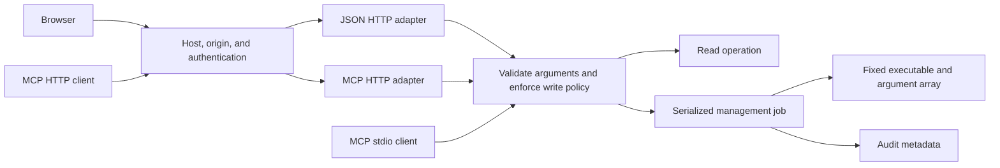

# Architecture

server-man runs as one Linux process for the web UI, authenticated JSON APIs and MCP HTTP. An agent can also launch a standalone stdio process. Both transports call the same management registry.

## Components

| Path | Responsibility |
| --- | --- |
| `cmd/server-man/` | Configuration, module assembly, HTTP listener, shutdown |
| `internal/app/` | Register the application's modules and tools |
| `internal/auth/` | Private access token, browser sessions, host/origin restrictions |
| `internal/declarative/` | Portable typed YAML model, private revision-checked store/history, VM identities, file preflight, configuration tools and journaled apply coordinator (implementation in progress) |
| `internal/core/` | Tool schemas, validation, write policy, process execution, jobs, audit |
| `internal/modules/monitor/` | Shared Linux resource sampler, bounded history and read-only tools |
| `internal/modules/compose/` | Project discovery, safe metadata parsing and fixed Compose/native-engine commands |
| `internal/modules/machines/` | Independent LXD/classic LXC/libvirt capabilities, whitelisted inventory, lifecycle and XML import |
| `internal/modules/services/` | System/user systemd inventory, selected properties, bounded journal and fixed service actions |
| `internal/modules/shares/` | Owned Samba/NFS fragments, selected host inventory, revision checks, validated publication and runtime rollback |
| `internal/modules/updates/` | Native package-family detection, cached candidates, serialized refresh/install and reboot hints |
| `internal/httpapi/` | HTTP transport, request limits, authentication, JSON responses |
| `internal/mcp/` | MCP tools protocol, stdio and stateless Streamable HTTP adapters |
| `internal/webui/` | Embed and serve production assets |
| `web/src/` | Responsive Svelte UI; API client, login, job activity, monitoring, Compose and agent access |
| `tools/mcp/` | Test-only official SDK client and HTTP handler bridge |

Dependency direction is entry point → assembly/transports → core. Domain modules depend on core interfaces, and do not import HTTP or UI packages. Assembly receives configuration, jobs, the shared sampler and a command executor. Tests inject a command recorder. A module supplies a capability descriptor and named tools; the registry provides discovery to transports.

## Declarative configuration foundation

The application registers configuration read/validate/health and preview/save/apply-status/retry tools through the same core registry. The absolute bootstrap `manifestPath` selects the portable workload YAML, defaulting to `stateDir/server-man.yaml`. The store validates, preserves guest identities, performs private atomic revision-checked saves and retains bounded exact-byte history. Static file preflight never creates missing data and explicitly does not claim runtime readiness. A file-based coordinator journals desired saves and per-resource publication/verification, with dependency ordering, drift inspection and refusal to blindly replay uncertain removals. No native adapters are wired to it yet; such configurations remain explicitly blocked. Full native apply, backend adapters and the UI are still being implemented; existing workload modules remain active. See [current foundation behavior](docs/design/declarative.md) and [remaining implementation work](docs/plans/declarative-management.md).

Domain rules and workflows follow DRY, KISS and YAGNI: share validation and management functions across transports, keep interfaces explicit, and avoid speculative infrastructure.

## Operation flow

Tools define their fields once. The registry derives an input JSON Schema and uses those same fields to reject unknown parameters, incorrect types, invalid enums, missing fields, and values outside declared limits. Domain modules must also validate resource names and file paths before using them. There is no shell execution API or arbitrary program API.

Reads run with a 20 second request deadline, at most four at once. Monitoring reads use the shared cached sampler rather than recollecting for every request. Management writes require `allowWrites: true` in server configuration. They return a job immediately and execute independently of the requesting connection. A destructive tool additionally requires `confirm: true`. The job cancellation control runs immediately through the same registry and write policy.

The monitoring module samples Linux every one to ten seconds, keeping up to 60 aggregate history points and one current process list. Native SVG charts and CSS meters render the dashboard. Missing data, initial/reset counters, stale snapshots, process limits and namespace scope are explicit. See [monitoring design](docs/design/monitoring.md) for source mappings and calculation rules.

Compose discovery reads file metadata without opening configuration or environment contents. Inventory runs at most one native container query per engine; selected project details and actions delegate project interpretation to its Compose provider. Only whitelisted container/pod metadata is returned. See [Compose design](docs/design/compose.md) for path checks, provider differences and command limits. The UI's shared `startJob` helper opens Activity; completion events refresh the selected project after its job finishes.

Machine management fixes backend context in configuration and uses separate executables for LXD and classic LXC. Libvirt mutations resolve the selected domain to a UUID before execution. Deletion checks stopped/inactive state; no disk-removal flags are exposed for libvirt. XML import checks a configured directory boundary and passes a private validated snapshot to `virsh define --validate`. See [machine design](docs/design/machines.md) for CLI mappings and verification limits.

Service management accepts an explicit system/user scope, defaulted by configuration, merges installed unit files with loaded runtime state and reports partial reads explicitly. Only exact validated `.service` names reach lifecycle or journal commands. Details select an explicit property allowlist; enablement does not imply a runtime start/stop. See [service design](docs/design/services.md) for parser compatibility, limits and permissions.

Shares store typed definitions as comments beside their generated native fragment. Ownership markers and deterministic rendering reject foreign/externally edited files. Mutations require a current revision, validate a temporary candidate, check for concurrent edits, then rename/sync the owned file. Samba validates an include-substituted shadow with testparm and requests reload; NFS changes only the selected export pairs through targeted exportfs commands. Failure restores the prior file and attempts native rollback. Cleanup has an independent 30-second deadline so cancellation can restore state; job cancellation preserves rollback diagnostics. See [share design](docs/design/shares.md) for exact guarantees and limits.

Updates choose the native package family from os-release plus installed executables, with an explicit configuration override. Reads never refresh repositories. Package mutations use fixed commands under the shared job lock; install combines refresh and normal updates in one job. Pacman refresh uses checkupdates' isolated database, while installation performs a full sync/system upgrade. Exit-code exceptions are specific to their command; separate capture diagnostics distinguish an empty pacman query from a database failure. See [update design](docs/design/updates.md) for repository, deferred-package and reboot limits.

## Resource bounds and failure handling

- One management job runs at a time across modules and processes sharing a state directory. A file lock is held until completion/cancellation and its audit record. A competing write receives a `busy` error. No queue or database is needed.
- Jobs have a 30 minute deadline and are cancelled on server shutdown. Commands default to a 20 minute timeout and reads captured through the runner default to 15 seconds.
- Child commands get their own process group. Default cancellation kills the group and bounds inherited output pipes to two seconds. Package mutations first send SIGINT, allow 30 seconds for native cleanup, then kill the group if necessary; their pipe wait includes that grace period.
- Command capture separates stdout from diagnostics and rejects output above 1 MiB. Job output retains the newest 128 KiB.
- Keep 64 recent jobs in memory; restarting the process clears job history. Job metadata can be listed separately from an individual job's output/result.
- Record start, cancellation request, and terminal state in a private JSONL audit log. Arguments, results, output, and credentials are excluded. Rotate at approximately 4 MiB and keep one previous file.
- Failure to record a job's start prevents execution. A failure to record completion is reported explicitly, even if the host operation already ran.
- Job cancellation stops remaining work; it does not undo changes already made by a backend. Each domain module must handle its own transaction/rollback requirements.

## Authentication and privileges

The server creates a 32 byte random access token in an owner-only file, and keeps its SHA-256 digest for comparison. The token file can be configured; it cannot be a symlink or group/world readable. Browser sign-in exchanges the token for a random HttpOnly, SameSite Strict cookie with an eight hour lifetime. Up to 32 browser sessions are kept in memory; logout removes a session and restart expires them all. The UI does not store the access token in browser storage.

HTTP clients can send a bearer token instead of a cookie. API bodies are limited to 1 MiB, login bodies to 4 KiB, and management requests use JSON. Reject unexpected Host headers and foreign Origin headers, including on requests with bearer tokens. A configured HTTPS `publicOrigin` permits a reverse proxy's external hostname; otherwise the HTTP listener and allowed hosts are local. The health endpoint reveals only whether the process responds.

The main process has the permissions of its operating-system account. With
`privilegedOperations` enabled, a registry execution wrapper routes package/share
operations and system-service operations through the fixed root-owned
`server-man-admin` helper using noninteractive sudo. User services execute as the
main account. The existing registry still owns schema validation, write policy,
jobs and audit for both HTTP and MCP. The helper revalidates schemas and domain
inputs, restricts operation names, rejects user-service scope, fixes privileged
paths, clears inherited environment, and locks across invocations before running
complete domain transactions. It has no transport listener. Root commands retain
bounded execution/output; signals cancel their process groups with package grace
periods. Helper output is bounded and returned when the operation finishes.
Missing helpers, sudo policy, and denied permissions fail explicitly. Future
modules must not add arbitrary privileged command execution. Rootless Podman belongs to the invoking account; running as root does not access another user's rootless inventory.

MCP HTTP reuses this authentication/origin boundary. Stdio is accessed by launching a process under the workload's operating-system account; it does not require a browser token. Each process owns its recent in-memory jobs. See [MCP design and connection examples](docs/design/mcp.md) for lifecycle, result shapes, cancellation, shared-state locking and protocol compatibility.

## Verification

`make check` runs Go vet and frontend type checking. `make test` runs race tests for configuration, authentication, HTTP/MCP policy, tool validation, job bounds/cancellation/locking, output capture, and process timeouts. `make mcp-test` verifies the built stdio server and HTTP handler with the official SDK. Building frontend assets first also enables embedded production asset checks. Command-changing domain integration tests must use fixtures or a command recorder; development verification must preserve the host's actual workloads.

The migrated headless host verifies loopback TCP HTTP, official SDK MCP HTTP, native read-only inventory and headless Firefox over real sockets. The sandbox launcher itself is unavailable, so verification uses the approved host execution path. Privileged mutations remain fixture-verified. See the [verification audit](docs/verification.md) and [operations ledger](docs/operations/host-setup.md) for exact evidence and remaining TLS/provider/CI limits.
